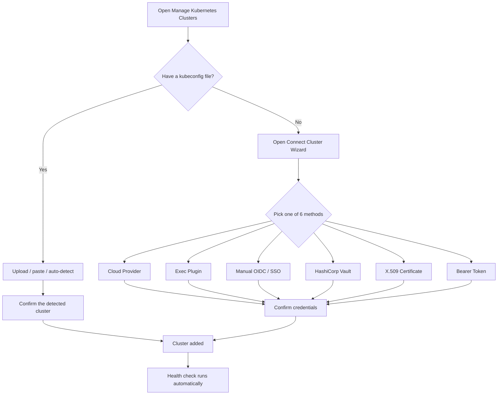

# Connect your first cluster

The first screen after install is **Manage Kubernetes Clusters**. ROZOOM doesn't create clusters - it only connects to ones you already have.

Nothing connects automatically. Every detected, pasted, or manually entered credential needs a confirmation click before ROZOOM touches it.

## Already have a kubeconfig?

Three ways in:

- **Upload a kubeconfig file**
- **Paste kubeconfig YAML** directly
- **Let ROZOOM scan standard locations** (`~/.kube/config`, `$KUBECONFIG`, cloud CLI config dirs) - matches show up under **Detected kubeconfig files**, ready to add individually or all at once.

## No local kubeconfig? Use the Connect Cluster Wizard

Open the collapsible **Connect Cluster** panel for six ways to authenticate without a kubeconfig file on disk:

| Method | Best for | How it works |
| --- | --- | --- |
| **Cloud Provider** | AWS EKS, GKE, AKS, DigitalOcean | One-click import via the provider's own CLI, with cross-region discovery. `aws`, `az`, `doctl` are bundled with ROZOOM; `gcloud` for GKE must be installed separately. |
| **Exec Plugin** | Teams already using a client-go credential plugin | Recommended by the Kubernetes project - returns a short-lived token on every API call, nothing long-lived written to disk. |
| **Manual OIDC / SSO** | Azure AD, Okta, Keycloak, Google, or a generic OIDC provider | Generates a kubeconfig with a `kubelogin` exec plugin. |
| **HashiCorp Vault** | Teams issuing dynamic cluster credentials | Token, Kubernetes, OIDC, or AppRole auth against Vault. |
| **X.509 Certificate** | Mutual TLS setups | Client certificate + private key (base64 PEM). |
| **Bearer Token** | Quick static access, CI tokens | Static or ServiceAccount token - no auto-rotation, ROZOOM warns you up front. |

Both the **Connect Cluster** and **Cloud Providers** panels are collapsed by default.

## What happens after you connect

Once a cluster is added, ROZOOM runs a health check immediately - see [Pausing the linter](/user/pausing-linter/) for how results appear and how to pause checks.

